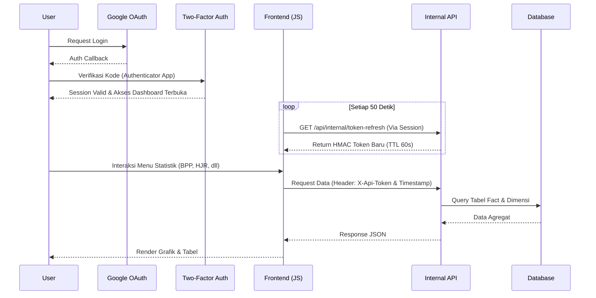

# Dashboard Analytics PLN

Sistem dashboard internal untuk memonitor dan menganalisis metrik operasional PLN. Sistem ini menampilkan data historis, grafik kinerja, dan statistik utama seperti BPP, HJR, Susut (Losses), Penjualan, Pendapatan, dan Tunggakan. 

## Alur Sistem & Arsitektur Keamanan

Akses ke data analitik diproteksi melalui proses autentikasi berlapis dan token rotasi cepat untuk komunikasi API internal.

## Kompleksitas Autentikasi dan Data API

Sistem memisahkan akses halaman web dan rute pengambilan data (headless approach pada API):
1. **Google OAuth & 2FA**: Semua pengguna masuk melalui SSO Google, dilanjutkan dengan tahap 2FA. Admin memiliki kendali untuk melihat log, melakukan *approve/reject* perangkat yang login, serta mereset pengaturan 2FA pengguna.
2. **Rotasi Token HMAC**: Endpoint data (`routes/api.php`) diakses tanpa state session konvensional. Sebagai gantinya, Client JS secara berkala mengambil token HMAC (`/api/internal/token-refresh`) yang hanya berlaku 60 detik. Token disematkan di header `X-Api-Token` bersama waktu pembuatan pada `X-Api-Timestamp` untuk setiap request.
3. **Rate Limiting Ketat**:
   - Alur login OAuth dibatasi 10 request per menit.
   - Pengecekan 2FA dibatasi 5 request per menit untuk mencegah brute-force.
   - Endpoint pemuatan grafik API dibatasi 60 request per menit (per user/IP).

## Fitur Utama

- **Modul Kinerja Terpusat**: Panel analitik untuk metrik BPP, HJR, Babin, Jam Nyala, Losses (Susut), P2TL, Pelanggan, kVA, Pendapatan, Penjualan, Rp/kWh, dan Tunggakan.
- **Manajemen Data Historis (Fact Entry)**: Fasilitas impor data terstruktur melalui Excel, input form manual, dan kalkulasi otomatis.
- **Kontrol Hak Akses**:
  - *Guest*: Login panel.
  - *User*: Akses baca dashboard, halaman statistik, dan profil.
  - *Admin*: Panel manajemen pengguna, device log, manajemen otorisasi 2FA.

## Stack Teknologi

- **Backend**: Laravel
- **Auth**: Laravel Socialite (Google OAuth), Google2FA
- **Database**: MySQL dengan penerapan skema Data Warehouse sederhana (Tabel Fact & Dimensi)
- **Frontend**: Blade templates, Vite, dan Javascript native client yang menangani refresh token secara otomatis.
